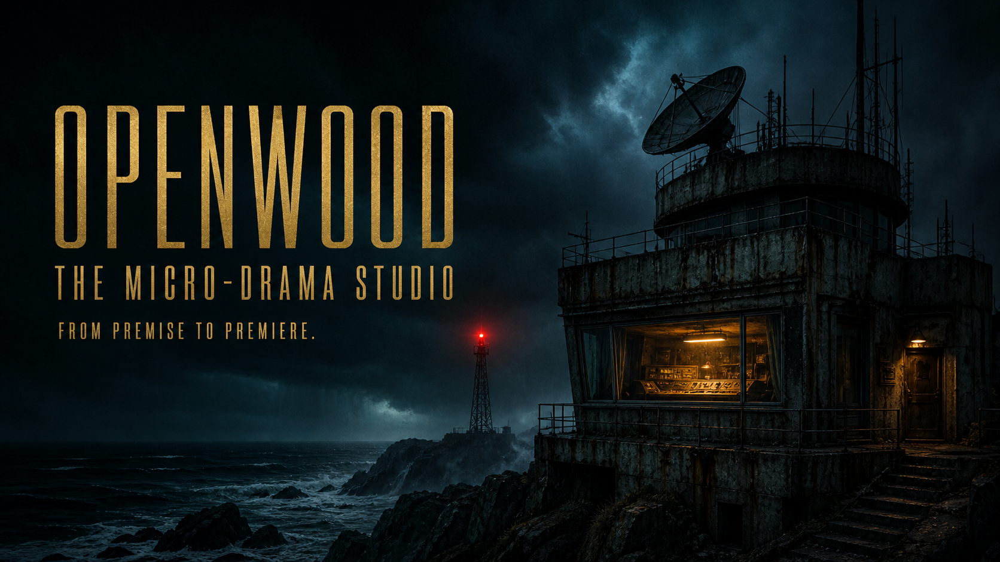

# OpenWood

OpenWood is an open-source production house for cinematic micro-dramas. It turns a premise into a durable, versioned production—not a chat transcript: brief, story bible, episode beats, screenplay, look bible, shot plan, sound cues, edit timeline, continuity and rights ledgers, independent QC, and an exportable release package.

The application opens directly into a working studio. There is no account wall, no ChatGPT dependency, and no API key required to explore and export the read-only **Dead Air** fixture, create a private anonymous production, author versioned artifacts manually, upload rights-tracked assets, and review an animatic.



## What works

- A cinematic studio lot with a real persisted slate and structured greenlight form.
- A complete authored **Dead Air** development fixture: eight episodes, pilot script v7, 19-shot deck, sound cue sheet, animatic timeline, continuity ledger, rights record, and evidence-based QC report. It is clearly read-only and does not pretend to contain footage that does not exist.
- Fifteen specialist production agents with explicit skills, input/output contracts, tool allowlists, and acceptance gates—including an Audience Dramaturg who authors consequence-bearing Story Doors without taking final cut from the showrunner.
- A deterministic workflow state machine, evidence-based transition gates, and comprehensive final-chain revalidation before mastering or release.
- Immutable artifact revisions with project-level compare-and-swap locking, so an edit/upload and a gate/master cannot both win against the same snapshot.
- Durable D1 records for productions, episodes, artifacts, versions, runs, events, issues, and asset provenance.
- R2-backed uploads up to 32 MB with byte-signature validation, SHA-256 checksums, provenance, and rights status. The bound keeps multipart parsing and master inspection reliable within a standard Worker isolate; larger facilities can add direct-to-R2 multipart ingest.
- A capability-routed Model Fabric for local FreeToken/Ollama/vLLM, private gateways, or hosted OpenAI-compatible models. Story, planning, and critic work can use different endpoints while legacy single-provider configuration remains valid; credentials remain server-side.
- An accessible screening room that plays a cleared uploaded video master when present, with byte-range seeking, WebVTT captions, SMPTE-style timecode, chapter seeking, keyboard transport, fullscreen, and lights-down mode. The demo falls back to a clearly labeled key-art animatic with synthesized room tone.
- Story Doors: an approved, version-pinned participation artifact can open one cinematic audience choice at an authored moment. A viewer signals anonymously, aggregate percentages appear only after participation, and the showrunner’s payoff promise remains inspectable. There are no fake counts, streak penalties, forced autoplay, or hidden feed ranking.
- Downloadable production-package JSON containing complete artifact revision history, run events, credits, open issues, asset hashes, and release state.
- Responsive production surfaces for desktop, tablet, and mobile.

The included premiere is an interactive animatic, not a falsely advertised rendered film. OpenWood deliberately does not claim to synthesize final footage or voices when those media providers are not connected.

## Quick start

Requirements: Node.js 22.13 or newer.

```bash
npm install
npm run dev
```

Open the local URL printed by the development server. D1 and R2 use project-local development state.

Run the static verification suite:

```bash
npm run check
```

Useful individual commands:

```bash
npm run typecheck
npm test
npm run lint
npm run build
npm run db:generate
```

With the development server running on port 3001, exercise the full HTTP acceptance path (all legal gates, a real H.264/AAC upload, D1/R2 persistence, atomic mastering, release, range playback, caption delivery, terminal immutability, and source-vault privacy):

```bash
npm run test:smoke
```

## Connect model workers

Manual mode is the safe default. To activate creative agents, copy `.env.example` to an ignored local environment file and configure an OpenAI-compatible endpoint. This legacy route remains the fallback for every text capability:

```dotenv
OPENWOOD_LLM_BASE_URL=http://localhost:11434/v1
OPENWOOD_LLM_MODEL=qwen3:30b
OPENWOOD_LLM_API_KEY=
```

For hosted or gateway endpoints, set `OPENWOOD_LLM_API_KEY` on the server. Never expose provider credentials through `NEXT_PUBLIC_*` values. The health endpoint returns only non-secret status:

```text
GET /api/health
```

Every stage requests one or more typed JSON artifacts and stores them as draft revisions. Provider failures are recorded against the assigned department; successful upstream work is preserved. A human must approve every draft and explicitly request each legal workflow edge.

For different story, planning, and critic workers—or for a guarded FreeToken pilot—use the capability-specific variables documented in [Model Fabric](docs/MODEL_FABRIC.md). FreeToken is an optional local text runtime, not a video, image, audio, or platform dependency. OpenWood’s durable artifacts remain portable when models change.

## Production workflow

```text
IDEA → BRIEF_READY → GREENLIT → BIBLE_LOCKED → OUTLINE_LOCKED
     → SCRIPT_DRAFT → SCRIPT_LOCKED → PREPRO_LOCKED → PRODUCING
     → ASSETS_READY → ROUGH_CUT → FINAL_QC → PICTURE_LOCKED
     → MASTERED → RELEASED
```

Agents do not mutate state or the database directly. A deterministic orchestrator selects the department, verifies the current state and approved inputs, calls the configured provider, validates all required output kinds, creates draft revisions, persists reported issues, and records the run. A separate deterministic transition command enforces the next legal edge and evidence gate. Human approval remains explicit throughout.

See [Agent company](docs/AGENT_COMPANY.md), [Architecture](docs/ARCHITECTURE.md), [Model Fabric](docs/MODEL_FABRIC.md), the dated [Model portfolio](docs/MODEL_PORTFOLIO.md), and [Storyworld protocol](docs/STORYWORLD_PROTOCOL.md).

## API surface

| Endpoint | Purpose |
| --- | --- |
| `GET /api/projects` | List the durable slate |
| `POST /api/projects` | Create and normalize a production brief |
| `GET /api/projects/:id` | Read a production bundle |
| `POST /api/projects/:id/artifacts` | Start a human-authored artifact draft |
| `POST /api/projects/:id/run` | Run one bounded agent stage |
| `POST /api/projects/:id/transition` | Evaluate and request a quality-gated transition |
| `POST /api/projects/:id/master` | Hash exact versions/assets and build the locked master manifest |
| `PATCH /api/artifacts/:id` | Create an optimistic, immutable revision |
| `PATCH /api/issues/:id` | Resolve an evidence-backed issue while retaining its ledger entry |
| `GET/POST /api/projects/:id/assets` | List or upload provenance-tracked assets |
| `GET /api/assets/:id` | Stream an owner-visible asset or a manifest-approved public playback deliverable |
| `GET /api/projects/:id/export` | Download the production package |
| `GET /api/runs/:id` | Inspect a durable run |
| `GET /api/runs/:id/events` | Replay ordered run events from a cursor |
| `GET /api/agents` | Inspect the resident company contracts |
| `GET /api/provider` | Read non-secret provider status |
| `GET/POST /api/watch/:slug/pulse` | Read a public Story Door and anonymously create or change one audience signal |
| `GET/PATCH /api/projects/:id/pulse` | Read aggregates or open/close release-pinned Story Doors inside the owning production room |
| `GET /api/worlds/:slug` | Discover a portable public storyworld and its participation contract |
| `GET /api/health` | Verify database and provider readiness |

## Deployment

Build the Cloudflare Worker-compatible bundle:

```bash
npm run build
npm start
```

The standalone Worker binds `DB` to D1 and `FILES` to R2 in `vite.config.ts`. Set `OPENWOOD_D1_DATABASE_ID`, `OPENWOOD_D1_DATABASE_NAME`, `OPENWOOD_R2_BUCKET_NAME`, and `OPENWOOD_PUBLIC_ORIGIN` in your build environment for a public deployment. No OpenAI or ChatGPT hosting product, account system, or login wall is involved.

A container recipe is included for local evaluation. It runs the built Worker through Wrangler’s local runtime; use `wrangler deploy` with real D1/R2 identifiers for an internet deployment:

```bash
docker compose up --build
```

To pass a local provider configuration into the container without copying secrets into the image, use `docker compose --env-file .env.local up --build`.

## Security and creative rights

- Uploaded material is untrusted story input, never model instructions.
- A high-entropy HttpOnly anonymous-workspace cookie isolates private productions without presenting a login wall.
- Every mutation requires a same-origin custom request header; model runs also have per-workspace and deployment-wide daily budgets.
- Audience signals use a dedicated HttpOnly cookie scoped to the public pulse API. Its raw token is never persisted: an HMAC-derived viewer key is different for every project and exact manifest version, preventing database-level cross-story tracking. Each changed/created signal consumes an atomic, bounded 60-second storyworld budget; idempotent repeats do not. No IP address, fingerprint, email, or account identifier is stored.
- The dramatic contract remains immutable in the release manifest, while an owner-only operational record can close or reopen signaling without rewriting history.
- Keys stay server-side; exported projects never include credentials.
- Assets require a provenance statement, explicit rights state, and a server-verified file signature.
- Mastered and released packages reject further artifact, agent, and asset mutations; public playback resolves only manifest-pinned media.
- Voice and likeness use requires affirmative consent records before release.
- The independent Rights & Safety Producer and Final Critic can block release.
- Public screening pages receive only approved playback data, not private notes or provider details.
- Only the authored public demo and productions in `RELEASED` state are publicly screenable.
- This repository ships no real person’s likeness, cloned voice, copyrighted franchise, or uncleared music.

Read [SECURITY.md](SECURITY.md) before exposing generation endpoints publicly.

## Project layout

```text
app/                  standalone UI, route handlers, production and premiere surfaces
db/                   D1 schema, initialization, fixtures, repositories
lib/agents/           versioned resident-company contracts
lib/domain/           durable types and quality gates
lib/orchestration/    deterministic stage runner
lib/providers/        OpenAI-compatible provider boundary
public/media/         project-owned demo artwork
tests/                domain, contract, and gate tests
.github/              CI quality gate and dependency updates
docs/                 architecture and agent company reference
```

## License

Apache License 2.0. See [LICENSE](LICENSE).
