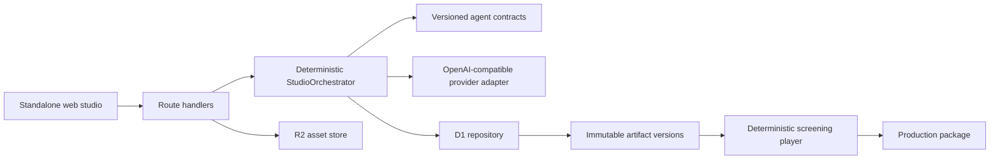
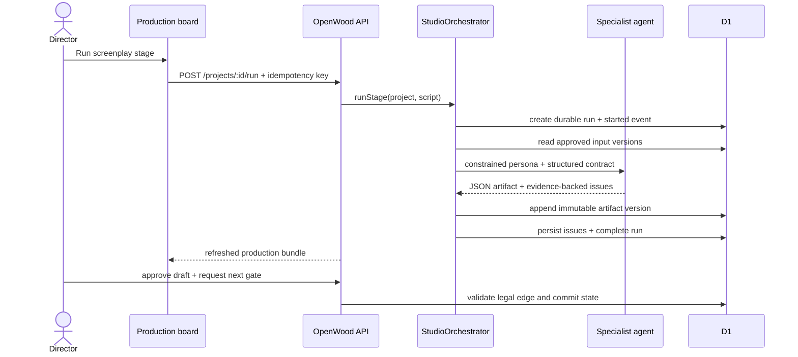

# OpenWood architecture

OpenWood adapts the strongest production patterns from [OpenMAIC](https://github.com/THU-MAIC/OpenMAIC)—typed artifacts, durable auditable runs, constrained agent tools, provider-neutral capabilities, and deterministic playback—into a film-production domain. It does not reuse OpenMAIC’s education-specific DSL or renderer.

## System boundaries

The browser never calls a model provider directly. The orchestrator—not an LLM supervisor—owns input validation, idempotency, persistence, stale-run recovery, issue capture, and output validation. A separate deterministic transition service owns legal edges and quality gates.

## Core invariants

1. Handoffs are versioned artifacts, not conversational memory.
2. Agents can act only through their explicit tool allowlist.
3. A provider response never mutates production state directly.
4. Every revision records its author, version, content hash, and timestamp.
5. Every gate-relevant mutation compares the exact project state and `content_revision`; stale or concurrent writes fail with HTTP 409.
6. Provider failures preserve all completed upstream artifacts.
7. Assets require SHA-256, source/ownership provenance, and rights state.
8. Master creation, manifest versioning, and the `MASTERED` transition commit in one serialized D1 batch against a stable package revision.
9. A final gate revalidates the complete artifact chain, every asset right, affirmative consent, timed captions, independent QC, blockers, and playable master.
10. A release must reference exact versions, hashes, timeline, and playable master; it cannot pass an open blocker.
11. Public screenings expose only manifest-pinned playback video/poster and never source-vault documents, private issues, or credentials.
12. Missing media capability is reported honestly; the platform does not substitute fake success.
13. Mastering freezes content. Further creative work requires a new production revision rather than mutating the public release.

## Request lifecycle

## Persistence

- `projects` indexes the anonymous workspace, slate, workflow state, and monotonic content revision used for compare-and-swap commits.
- `episodes` stores queryable release units.
- `artifacts` points to current revisions; `artifact_versions` is append-only.
- `agent_runs` and `run_events` preserve execution history and idempotency; a partial unique lease prevents two active runs for the same stage.
- `issues` stores evidence-backed quality, safety, rights, and continuity findings.
- `assets` stores R2 keys, hashes, media types, rights status, and provenance.

The current application commits generated SQL migrations and also performs an idempotent bootstrap for zero-configuration local development. Upgrade hardening reconciles invalid legacy duplicate artifact rows before installing uniqueness constraints; the versioned demo fixture is replaced atomically. A larger deployment can apply the SQL migration before traffic or replace the repository with PostgreSQL without changing domain contracts.

## Provider boundary

`lib/providers/openai-compatible.ts` supports local or hosted endpoints that implement `POST /chat/completions`. Configuration is server-only. Each call includes the assigned persona, concrete skills, acceptance gate, production metadata, and approved input artifacts. Source text is explicitly marked as untrusted material.

## Honest rendering scope

The premiere plays the exact rights-cleared video and timeline pinned in the locked release manifest, streams the master with byte ranges, and exposes a generated WebVTT caption track. Before a master exists, it uses a clearly labeled deterministic key-art animatic over the edit timeline with generated room tone. Built-in image/video/voice synthesis and distributed rendering are deliberately outside this repository; deployments can add media adapters and an FFmpeg worker without changing the artifact or timeline contracts.
