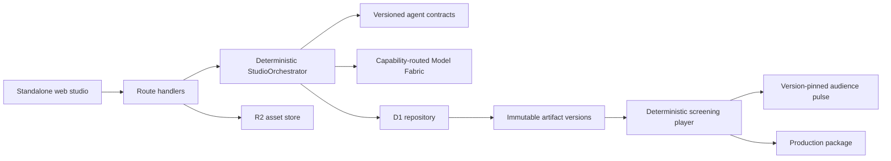

# OpenWood architecture

OpenWood adapts the strongest production patterns from [OpenMAIC](https://github.com/THU-MAIC/OpenMAIC)—typed artifacts, durable auditable runs, constrained agent tools, provider-neutral capabilities, and deterministic playback—into a film-production domain. It does not reuse OpenMAIC’s education-specific DSL or renderer.

## System boundaries



The browser never calls a model provider directly. The orchestrator—not an LLM supervisor—owns input validation, idempotency, persistence, stale-run recovery, issue capture, and output validation. A separate deterministic transition service owns legal edges and quality gates.

## Core invariants

1. Handoffs are versioned artifacts, not conversational memory.
2. Agents can act only through their explicit tool allowlist.
3. A provider response never mutates production state directly.
4. Every revision records its author, version, content hash, and timestamp.
5. Every gate-relevant mutation compares the exact project state and `content_revision`; stale or concurrent writes fail with HTTP 409.
6. A model stage commits every generated artifact revision, issue, completed run state, and event in one D1 batch only if its source state, source content revision, running lease, and output artifact versions still match. A stale multi-output result applies nothing and returns HTTP 409.
7. Provider failures preserve all completed upstream artifacts.
8. Assets require SHA-256, source/ownership provenance, and rights state.
9. Master creation, manifest versioning, and the `MASTERED` transition commit in one serialized D1 batch against a stable package revision.
10. A final gate revalidates the complete artifact chain, every asset right, affirmative consent, timed captions, independent QC, blockers, and playable master.
11. A release must reference exact versions, hashes, timeline, and playable master; it cannot pass an open blocker.
12. Public screenings expose only manifest-pinned playback video/poster and never source-vault documents, private issues, or credentials.
13. Missing media capability is reported honestly; the platform does not substitute fake success.
14. Mastering freezes content. Further creative work requires a new production revision rather than mutating the public release.
15. Audience signals bind to the exact approved participation artifact and version; changing the prompt cannot silently inherit an earlier vote.
16. Aggregate audience results appear to a public viewer only after that viewer participates. Counts are stored signals, never generated social proof.
17. Viewer identifiers are HMAC-derived from a separate HttpOnly audience token and the project plus exact manifest version, so stored rows cannot correlate one browser across storyworlds.
18. Signal writes and their bounded 60-second attempt counter commit atomically. Idempotent repeats do not consume the budget; choice changes also have a per-viewer cooldown.
19. A release-pinned Story Door contract is immutable, but its owner may open or close a separate operational state record without changing the authored promise.

## Request lifecycle

```mermaid
sequenceDiagram
    actor Director
    participant UI as Production board
    participant API as OpenWood API
    participant O as StudioOrchestrator
    participant A as Specialist agent
    participant DB as D1

    Director->>UI: Run screenplay stage
    UI->>API: POST /projects/:id/run + idempotency key
    API->>O: runStage(project, script)
    O->>DB: create durable run + started event
    O->>DB: read approved input versions
    O->>A: constrained persona + structured contract
    A-->>O: JSON artifact + evidence-backed issues
    O->>DB: atomic snapshot CAS: all revisions + issues + completed run
    alt production changed during inference
        DB-->>O: rollback complete batch
        O->>DB: mark run failed as superseded
        API-->>UI: HTTP 409; no generated work applied
    end
    API-->>UI: refreshed production bundle
    Director->>API: approve draft + request next gate
    API->>DB: validate legal edge and commit state
```

## Persistence

- `projects` indexes the anonymous workspace, slate, workflow state, and monotonic content revision used for compare-and-swap commits.
- `episodes` stores queryable release units.
- `artifacts` points to current revisions; `artifact_versions` is append-only.
- `agent_runs` and `run_events` preserve execution history and idempotency; a partial unique lease prevents two active runs for the same stage.
- `issues` stores evidence-backed quality, safety, rights, and continuity findings.
- `assets` stores R2 keys, hashes, media types, rights status, and provenance.
- `audience_signals` stores one anonymous, changeable signal per viewer and version-pinned Story Door. It stores no IP address, fingerprint, account, or contact identifier.
- `audience_signal_rate_windows` keeps one bounded attempt counter per project rather than counting mutable vote rows.
- `story_door_states` records owner-operated open/closed state against an exact released prompt version; it never rewrites the pinned participation artifact.

The current application commits generated SQL migrations and also performs an idempotent bootstrap for zero-configuration local development. Upgrade hardening reconciles invalid legacy duplicate artifact rows before installing uniqueness constraints; the versioned demo fixture is replaced atomically. A larger deployment can apply the SQL migration before traffic or replace the repository with PostgreSQL without changing domain contracts.

Agent-stage completion uses a transient, randomly keyed `system_meta` guard as the first statement in its batch. The guard inserts a non-null value only when the exact source snapshot and every target artifact expectation match; otherwise it deliberately violates the table's non-null constraint, causing D1 to roll back the batch. The final statement removes the transient guard. Content revision advances exactly once for the whole stage, regardless of how many outputs it produced.

## Provider boundary

`lib/providers/model-fabric.ts` resolves the requested story, planning, or critic capability to a local or hosted OpenAI-compatible endpoint. `lib/providers/openai-compatible.ts` performs the bounded structured call. Configuration is server-only, legacy single-provider variables remain a fallback, and non-secret status reports expose no keys. Each call includes the assigned persona, concrete skills, acceptance gate, production metadata, and approved input artifacts. Source text is explicitly marked as untrusted material.

## Honest rendering scope

The premiere plays the exact rights-cleared video and timeline pinned in the locked release manifest, streams the master with byte ranges, and exposes a generated WebVTT caption track. Before a master exists, it uses a clearly labeled deterministic key-art animatic over the edit timeline with generated room tone. Built-in image/video/voice synthesis and distributed rendering are deliberately outside this repository; deployments can add media adapters and an FFmpeg worker without changing the artifact or timeline contracts.
